<p align="center">
  
</p>

<p align="center">
  <a href="https://daneshselwal.github.io"></a>
  <a href="https://huggingface.co/DaneshSelwal"></a>
  <a href="https://www.kaggle.com/daneshselwal"></a>
  
</p>

<p align="center">
  <a href="https://github.com/DaneshSelwal"></a>
</p>


I work where **civil engineering meets machine learning**. Most of my research asks one question:
*how far can we trust a model's prediction?* I build pipelines that attach honest uncertainty to every
output, from conformal prediction sets on hyperspectral land-cover maps to prediction intervals for
concrete strength, bridge scour and sediment load.

```yaml
current_post : Graduate Engineer Trainee @ L&T Renewables   # Tashkent, Uzbekistan
education    : B.Tech Civil Engineering @ NIT Kurukshetra   # research with Prof. Mahesh Pal
research_log :
  - IIT Ropar      : land-use / land-cover mapping of the Singrauli mining region (Sentinel-2, GEE)
  - IIT Mandi      : physics-informed generative models for earthquake ground motion
  - Infosys        : AI/ML intern, Springboard
core_question: "how far can we trust a model's prediction?"
```



<table>
<tr>
<td width="33%" valign="top">

**`▸ VECTOR_01` 📐 Uncertainty**

Conformal prediction (split, class-conditional, RC3P, spatial), credal and deep ensembles,
quantile regression, NGBoost, diffusion-based uncertainty

</td>
<td width="33%" valign="top">

**`▸ VECTOR_02` 🛰️ Remote sensing**

Hyperspectral and multispectral classification, land-use / land-cover mapping, Sentinel-2,
Google Earth Engine, foundation models (DOFA, Mamba, ViT)

</td>
<td width="33%" valign="top">

**`▸ VECTOR_03` 🏗️ Engineering ML**

Concrete strength, pile settlement, bridge scour, sediment load, water quality, earthquake ground
motion, explainable AI (SHAP, LIME)

</td>
</tr>
</table>



<table>
<tr>
<td width="50%" valign="top">

`MISSION 01` **[DIAS-65Band-Hyperspectral-UQ](https://github.com/DaneshSelwal/DIAS-65Band-Hyperspectral-UQ)**<br>
11 deep classifiers × 11 uncertainty methods on a 65-band airborne hyperspectral scene. Shows when
"95% coverage on average" hides a class covered only 41.5% of the time.

`conformal` `hyperspectral` `TensorFlow`

</td>
<td width="50%" valign="top">

`MISSION 02` **[6Band-Multispectral-UQ](https://github.com/DaneshSelwal/6Band-Multispectral-UQ)**<br>
The companion 6-band study, with accuracy from 68.8% to 99.9%: how uncertainty methods behave on
weak models as well as near-perfect ones.

`conformal` `multispectral` `credal ensembles`

</td>
</tr>
<tr>
<td width="50%" valign="top">

`MISSION 03` **[Classification UQ Analysis](https://github.com/DaneshSelwal/Classification_Uncertainty_Quantification_Analysis)**<br>
The umbrella framework for uncertainty in remote-sensing classification: Bayesian deep learning,
ensembles, conformal and evidential methods across many datasets.

`framework` `remote sensing` `UQ`

</td>
<td width="50%" valign="top">

`MISSION 04` **[RegUQ](https://github.com/DaneshSelwal/reguq) · [Regression UQ Analysis](https://github.com/DaneshSelwal/Regression_Uncertainty_Quantification_Analysis)**<br>
A Python library and a plug-and-play framework for regression uncertainty: conformal prediction,
probabilistic forecasting and quantile methods.

`Python library` `prediction intervals`

</td>
</tr>
<tr>
<td width="50%" valign="top">

`MISSION 05` **[LULC Classification · Singrauli](https://github.com/DaneshSelwal/LULC_Classification_Singrauli_region)**<br>
IIT Ropar internship: a Google Earth Engine + Sentinel-2 pipeline with Optuna-tuned ML and CNNs for
six-class land-cover mapping of a mining region.

`GEE` `Sentinel-2` `CNN`

</td>
<td width="50%" valign="top">

`MISSION 06` **[Physics-informed CWGAN-GP](https://github.com/DaneshSelwal/physics-informed-CWGAN-ground-motion)**<br>
A conditional Wasserstein GAN that predicts earthquake spectral acceleration from seismological
parameters, with a physics-informed distance constraint.

`GAN` `seismology` `IIT Mandi`

</td>
</tr>
<tr>
<td width="50%" valign="top">

`MISSION 07` **ML for civil & environmental data**<br>
Uncertainty-aware prediction pipelines with Optuna, SHAP and conformal prediction:
[Concrete](https://github.com/DaneshSelwal/Concrete_data_analysis) ·
[Bridge scour](https://github.com/DaneshSelwal/ML_Analysis_Scour_Data) ·
[Sediment load](https://github.com/DaneshSelwal/ML_Analysis_Sediment_Load) ·
[Water quality](https://github.com/DaneshSelwal/ML_Analysis_Water_Quality) ·
[Pile settlement](https://github.com/DaneshSelwal/ML_Analysis_Pile_Settlement)

`MAPIE` `PUNCC` `NGBoost`

</td>
<td width="50%" valign="top">

`MISSION 08` **Tools for AI agents**<br>
[colab-mcp-server](https://github.com/DaneshSelwal/colab-mcp-server): a headless MCP server that lets
agents run Google Colab notebooks.
[agent-kaggle-runner](https://github.com/DaneshSelwal/agent-kaggle-runner): run notebooks on Kaggle
GPUs from a coding agent.
[HELIOS](https://github.com/DaneshSelwal/HELIOS-100MW-Solar-PV-BESS-PROJECT): an agent-run EPC
simulation of a 100 MW solar + storage plant.

`MCP` `agents` `automation`

</td>
</tr>
</table>


<p align="center">
  <br>
  
</p>

<p align="center">
  
  
  
  
  
</p>


<p align="center">
  
  
</p>

<p align="center">
  
</p>


