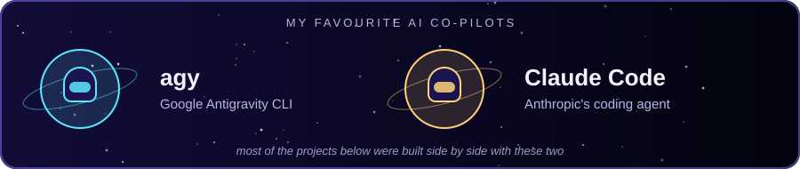
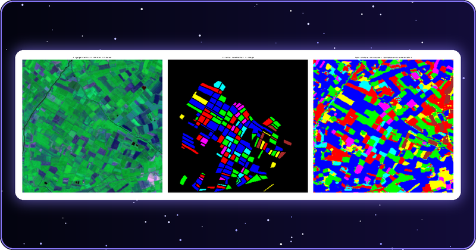
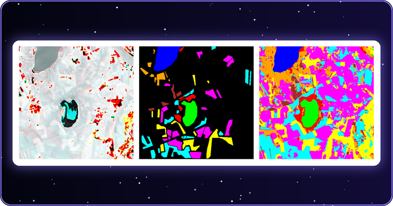
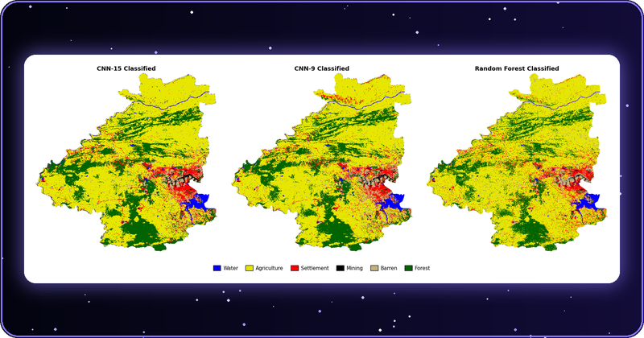
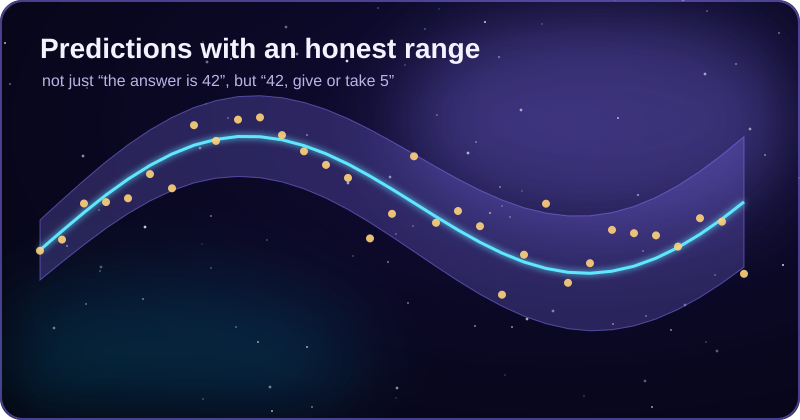
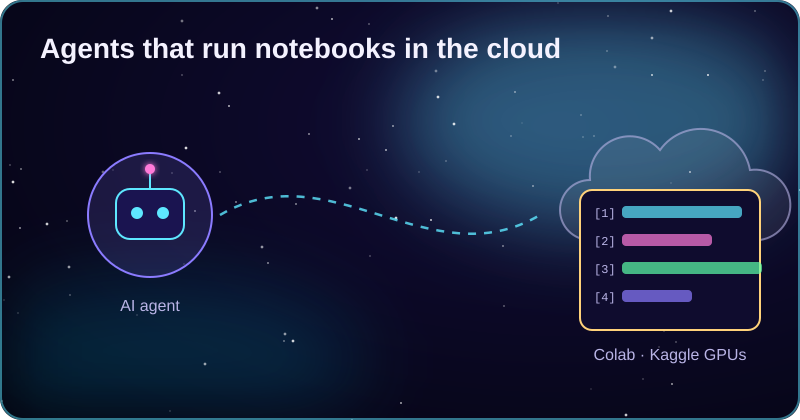
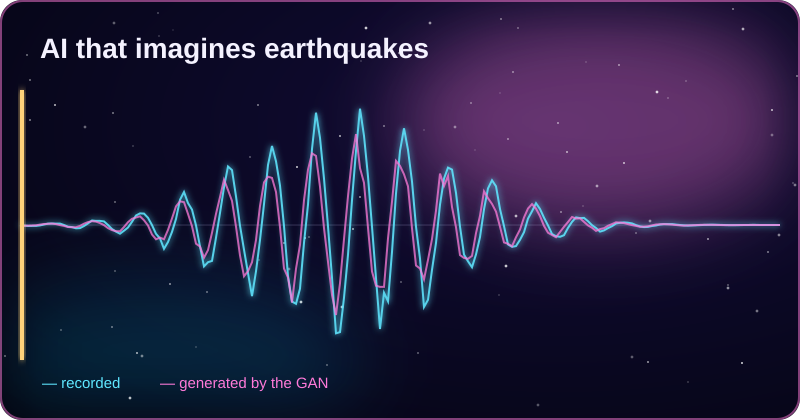

  
  

  

I'm a **civil engineer working with AI**, and the question I care about most is
**uncertainty**: *when an AI makes a prediction, how much should we trust it?* In civil engineering
a confident wrong answer can be costly (a weak concrete mix, a scoured bridge pier, a misread land
map), so I build models that give an honest range or set of answers, not just a single guess.

- 🚀 **Graduate Engineer Trainee, L&T Renewables** (Planning Department), working on the **Kungrad 1500 MW
  wind power plant + 300 MW battery storage** in Karakalpakstan, Uzbekistan: Central Asia's largest single-site
  renewable energy project
- 🎓 **B.Tech Civil Engineering, NIT Kurukshetra** (2022–26) and undergraduate research assistant with
  **Prof. Mahesh Pal**, studying uncertainty quantification for regression and classification
- 🛰️ **Research intern, IIT Ropar** with Dr. Shray Pathak: deep learning on Sentinel-2 satellite images for land-cover mapping
- 🌍 **IIT Mandi collaboration:** physics-informed generative AI for earthquake ground motion
- 💬 **Prompt engineer, Soul AI** (part-time): testing and comparing answers from different large language models
- 👁️ **AI/ML intern, Infosys Springboard:** built MediScan AI, which spots eye diseases in retinal images
- 📄 **2 journal papers, 2 conference papers** (one with a Best Paper Award) and more under review, all on uncertainty

<table>
<tr>
<td width="33%" valign="top" align="center">

### 🎯
**Uncertainty quantification**

Conformal prediction, ensembles and probabilistic models that tell you *how sure* the AI is

</td>
<td width="33%" valign="top" align="center">

### 🏗️
**Civil engineering core**

Concrete, foundations, bridges, rivers, water quality and earthquakes: real problems where trust matters

</td>
<td width="33%" valign="top" align="center">

### 🛰️
**Earth from space**

Satellite and airborne images turned into land maps, with a confidence for every pixel

</td>
</tr>
</table>

<table>
<tr>
<td width="16%" align="center">📘 <b>JOURNAL</b> 2026</td>
<td>

**[Uncertainty Estimation in Predicting Suspended Sediment Load Using Probabilistic Machine Learning and Conformal Prediction](https://doi.org/10.1061/JHYEFF.HEENG-6825)** 
*ASCE Journal of Hydrologic Engineering* · code: [ML_Analysis_Sediment_Load](https://github.com/DaneshSelwal/ML_Analysis_Sediment_Load)

</td>
</tr>
<tr>
<td align="center">📗 <b>JOURNAL</b> 2026</td>
<td>

**[Traffic Noise Modelling using Integrated Conformal Prediction Based Uncertainty Estimation with Machine Learning Algorithms](https://ijths.com/2026/04/12/traffic-noise-modelling-using-integrated-conformal-prediction-based-uncertainty-estimation-with-machine-learning-algorithms/)** 
*International Journal of Technology, Health and Sustainability (IJTHS)*

</td>
</tr>
<tr>
<td align="center">🏆 <b>BEST PAPER</b> 2026</td>
<td>

**[Conformal Prediction based Uncertainty Estimation for Remote Sensing Classifications](https://nitkkr.ac.in/international-conference-on-sustainable-planning-architecture-and-civil-engineering-space-2026-held-on-january-23-25-2026/)** 
*SPACE 2026 Conference*, **Best Paper Award** · code: [Conformal_Prediction_For_Remote_Sensing_6bands](https://github.com/DaneshSelwal/Conformal_Prediction_For_Remote_Sensing_6bands)

</td>
</tr>
<tr>
<td align="center">📙 <b>CONFERENCE</b> 2025</td>
<td>

**Uncertainty Estimation for Pier Scour Modelling using Conformal Prediction** 
*HYDRO 2025 International Conference* · code: [ML_Analysis_Scour_Data](https://github.com/DaneshSelwal/ML_Analysis_Scour_Data)

</td>
</tr>
<tr>
<td align="center">⏳ <b>UNDER REVIEW</b> 2026</td>
<td>

**Conformal Prediction based Uncertainty Estimation with Remote Sensing Data** 
*[IGARSS 2026](https://ingarss2026.co.in/)* · plus one more paper under review at *ICCDRH*

</td>
</tr>
</table>

<table>
<tr>
<td width="50%" valign="top">

### ☀️ [HELIOS](https://github.com/DaneshSelwal/HELIOS-100MW-Solar-PV-BESS-PROJECT)
`🟢 in progress`

A make-believe 100 MW solar + battery power plant, built from contract to handover, where **every
engineer, client and supplier is an AI agent** with its own personality. Each simulated day they hold
meetings, write letters and produce real project documents, and every day is saved as one git commit.
Brings my day job in renewables together with AI agents.

</td>
<td width="50%" valign="top">

### 🧭 [Classification UQ: the umbrella project](https://github.com/DaneshSelwal/Classification_Uncertainty_Quantification_Analysis)
`🟢 in progress`

My main research home: one framework that brings together many ways for an AI to say how sure it is
about a land-cover map (ensembles, Bayesian deep learning, conformal and evidential methods)
and tests them on several satellite and airborne datasets.

</td>
</tr>
</table>

<table>
<tr>
<td width="50%" valign="top">

### 🪐 [Which pixels can you trust?](https://github.com/DaneshSelwal/DIAS-65Band-Hyperspectral-UQ)
An airborne image with 65 colour bands, classified by 11 AI models. Each one is then asked how
confident it is about every single pixel. The
[6-band companion study](https://github.com/DaneshSelwal/6Band-Multispectral-UQ) repeats it on a simpler image.

</td>
<td width="50%" valign="top">

### 🛰️ [Mapping the Singrauli region](https://github.com/DaneshSelwal/LULC_Classification_Singrauli_region)
My IIT Ropar internship: maps of water, farms, forest, towns and mines in a coal-mining region,
made from Sentinel-2 satellite images with Google Earth Engine and deep learning.

</td>
</tr>
<tr>
<td width="50%" valign="top">

### 🌠 [Regression UQ](https://github.com/DaneshSelwal/Regression_Uncertainty_Quantification_Analysis) · [RegUQ](https://github.com/DaneshSelwal/reguq)
A plug-and-play framework, and a pip-installable Python library, that gives every prediction an
honest range instead of a single number.

</td>
<td width="50%" valign="top">

### 🤖 [Colab MCP server](https://github.com/DaneshSelwal/colab-mcp-server) · [Kaggle runner](https://github.com/DaneshSelwal/agent-kaggle-runner)
Tools that let AI agents like agy and Claude Code run my notebooks on free cloud GPUs in Google Colab
and Kaggle, with no browser clicking needed.

</td>
</tr>
</table>

<table>
<tr>
<td width="50%" valign="top">

### 🌋 [AI that imagines earthquakes](https://github.com/DaneshSelwal/physics-informed-CWGAN-ground-motion)
With IIT Mandi: a generative AI model, guided by physics, that predicts how the ground shakes
during an earthquake.

</td>
<td width="50%" valign="top">

### 🏗️ AI × civil engineering, with uncertainty
Prediction pipelines for core civil problems, each giving a **range** you can trust, not just a number:

- 🧱 [Concrete strength](https://github.com/DaneshSelwal/Concrete_data_analysis)
- 🌉 [Bridge pier scour](https://github.com/DaneshSelwal/ML_Analysis_Scour_Data): 📙 HYDRO 2025 paper
- 🏞️ [Sediment load in rivers](https://github.com/DaneshSelwal/ML_Analysis_Sediment_Load): 📘 ASCE journal paper
- 💧 [Water quality](https://github.com/DaneshSelwal/ML_Analysis_Water_Quality)
- 🏢 [Pile settlement](https://github.com/DaneshSelwal/ML_Analysis_Pile_Settlement)

</td>
</tr>
<tr>
<td colspan="2">

### 🎵 [MyTube Music](https://github.com/DaneshSelwal/Mytube_music): my Android app
A music player for the songs on your phone, written in Kotlin with Jetpack Compose. It has a spinning
vinyl record, karaoke-style synced lyrics, shake-to-skip, a sleep timer and a dark "Midnight Vinyl" look.
(I also made a small [Tip Calculator](https://github.com/DaneshSelwal/Tip-Calculator) app while learning Android.)

</td>
</tr>
</table>

  

  
  
  
  
  

  
  
  
  

