  

  

I'm a civil engineer who fell in love with **artificial intelligence**. I like asking simple questions
of smart machines: *what do you see, and how sure are you?* Most of my projects mix engineering,
satellite images and machine learning, and I learn something new with every one of them.

- 🚀 Currently a **Graduate Engineer Trainee at L&T Renewables** in Tashkent, Uzbekistan
- 🎓 Studied **Civil Engineering at NIT Kurukshetra**, where I started doing ML research
- 🛰️ Mapped land from satellite images as a research intern at **IIT Ropar**
- 🌍 Worked with **IIT Mandi** on AI for earthquake engineering
- 🤖 Learned AI and ML as an intern with **Infosys Springboard**

<table>
<tr>
<td width="33%" valign="top" align="center">

### 🤖
**Trustworthy AI**

Models that know when they might be wrong, and say so

</td>
<td width="33%" valign="top" align="center">

### 🛰️
**Earth from space**

Teaching AI to read satellite images and map the land below

</td>
<td width="33%" valign="top" align="center">

### 🏗️
**AI for engineering**

Using ML to understand concrete, rivers, soil and earthquakes

</td>
</tr>
</table>

<table>
<tr>
<td width="50%" valign="top">

🪐 **[Hyperspectral land-cover with uncertainty](https://github.com/DaneshSelwal/DIAS-65Band-Hyperspectral-UQ)** 
Classifying an airborne image with many colour bands, and showing how confident the AI is about each pixel.

</td>
<td width="50%" valign="top">

🌌 **[Multispectral land-cover with uncertainty](https://github.com/DaneshSelwal/6Band-Multispectral-UQ)** 
The companion study on a simpler image, comparing many ways for an AI to express doubt.

</td>
</tr>
<tr>
<td width="50%" valign="top">

🛰️ **[Mapping the Singrauli region](https://github.com/DaneshSelwal/LULC_Classification_Singrauli_region)** 
My IIT Ropar internship project: land-use maps of a mining region from Sentinel-2 satellite images.

</td>
<td width="50%" valign="top">

🌋 **[AI for earthquake ground motion](https://github.com/DaneshSelwal/physics-informed-CWGAN-ground-motion)** 
A generative AI model, guided by physics, that predicts how the ground shakes during an earthquake.

</td>
</tr>
<tr>
<td width="50%" valign="top">

🌠 **[RegUQ](https://github.com/DaneshSelwal/reguq)** 
A small Python library for giving predictions an honest range instead of a single number.

</td>
<td width="50%" valign="top">

🏗️ **ML for civil engineering** 
Predicting
[concrete strength](https://github.com/DaneshSelwal/Concrete_data_analysis),
[bridge scour](https://github.com/DaneshSelwal/ML_Analysis_Scour_Data),
[sediment load](https://github.com/DaneshSelwal/ML_Analysis_Sediment_Load),
[water quality](https://github.com/DaneshSelwal/ML_Analysis_Water_Quality) and
[pile settlement](https://github.com/DaneshSelwal/ML_Analysis_Pile_Settlement).

</td>
</tr>
</table>

  

  
  
  

