<picture>
  <source media="(prefers-color-scheme: dark)" srcset="assets/banner-dark.svg">
  
</picture>

  
  
  
  

  

## 👋 About me

I work where **civil engineering meets machine learning**. Most of my research asks one question:
*how far can we trust a model's prediction?* I build pipelines that attach honest uncertainty to every
output, from conformal prediction sets on hyperspectral land-cover maps to prediction intervals for
concrete strength, bridge scour and sediment load.

- ⚡ **Currently: Graduate Engineer Trainee at L&T Renewables**, Tashkent, Uzbekistan
- 🎓 **B.Tech Civil Engineering, NIT Kurukshetra.** Research on probabilistic prediction with Prof. Mahesh Pal
- 🛰️ **Research intern, IIT Ropar.** Land-use / land-cover mapping of the Singrauli mining region with Sentinel-2 and Google Earth Engine
- 🌍 **IIT Mandi collaboration.** Physics-informed generative models for earthquake ground motion
- 💼 **AI/ML intern, Infosys Springboard**

## 🔭 Research focus

<table>
<tr>
<td width="33%" valign="top">

**📐 Uncertainty quantification**

Conformal prediction (split, class-conditional, RC3P, spatial), credal and deep ensembles,
quantile regression, NGBoost, diffusion-based uncertainty

</td>
<td width="33%" valign="top">

**🛰️ Remote sensing**

Hyperspectral and multispectral classification, land-use / land-cover mapping, Sentinel-2,
Google Earth Engine, foundation models (DOFA, Mamba, ViT)

</td>
<td width="33%" valign="top">

**🏗️ ML for engineering**

Concrete strength, pile settlement, bridge scour, sediment load, water quality, earthquake ground
motion, explainable AI (SHAP, LIME)

</td>
</tr>
</table>

## 📌 Featured work

<table>
<tr>
<td width="50%" valign="top">

### [DIAS-65Band-Hyperspectral-UQ](https://github.com/DaneshSelwal/DIAS-65Band-Hyperspectral-UQ)
11 deep classifiers × 11 uncertainty methods on a 65-band airborne hyperspectral scene. Shows when
"95% coverage on average" hides a class covered only 41.5% of the time.

`conformal prediction` `hyperspectral` `TensorFlow`

</td>
<td width="50%" valign="top">

### [6Band-Multispectral-UQ](https://github.com/DaneshSelwal/6Band-Multispectral-UQ)
The companion 6-band study, with accuracy from 68.8% to 99.9%: how uncertainty methods behave on
weak models as well as near-perfect ones.

`conformal prediction` `multispectral` `credal ensembles`

</td>
</tr>
<tr>
<td width="50%" valign="top">

### [Classification UQ Analysis](https://github.com/DaneshSelwal/Classification_Uncertainty_Quantification_Analysis)
The umbrella framework for uncertainty in remote-sensing classification: Bayesian deep learning,
ensembles, conformal and evidential methods across many datasets.

`framework` `remote sensing` `UQ`

</td>
<td width="50%" valign="top">

### [RegUQ](https://github.com/DaneshSelwal/reguq) · [Regression UQ Analysis](https://github.com/DaneshSelwal/Regression_Uncertainty_Quantification_Analysis)
A Python library and a plug-and-play framework for regression uncertainty: conformal prediction,
probabilistic forecasting and quantile methods.

`Python library` `prediction intervals`

</td>
</tr>
<tr>
<td width="50%" valign="top">

### [LULC Classification · Singrauli](https://github.com/DaneshSelwal/LULC_Classification_Singrauli_region)
IIT Ropar internship: a Google Earth Engine + Sentinel-2 pipeline with Optuna-tuned ML and CNNs for
six-class land-cover mapping of a mining region.

`GEE` `Sentinel-2` `CNN`

</td>
<td width="50%" valign="top">

### [Physics-informed CWGAN-GP](https://github.com/DaneshSelwal/physics-informed-CWGAN-ground-motion)
A conditional Wasserstein GAN that predicts earthquake spectral acceleration from seismological
parameters, with a physics-informed distance constraint.

`GAN` `seismology` `IIT Mandi`

</td>
</tr>
<tr>
<td width="50%" valign="top">

### ML for civil & environmental data
Uncertainty-aware prediction pipelines with Optuna, SHAP and conformal prediction:
[Concrete](https://github.com/DaneshSelwal/Concrete_data_analysis) ·
[Bridge scour](https://github.com/DaneshSelwal/ML_Analysis_Scour_Data) ·
[Sediment load](https://github.com/DaneshSelwal/ML_Analysis_Sediment_Load) ·
[Water quality](https://github.com/DaneshSelwal/ML_Analysis_Water_Quality) ·
[Pile settlement](https://github.com/DaneshSelwal/ML_Analysis_Pile_Settlement)

`MAPIE` `PUNCC` `NGBoost`

</td>
<td width="50%" valign="top">

### Tools for AI agents
[colab-mcp-server](https://github.com/DaneshSelwal/colab-mcp-server): a headless MCP server that lets
agents run Google Colab notebooks.
[agent-kaggle-runner](https://github.com/DaneshSelwal/agent-kaggle-runner): run notebooks on Kaggle
GPUs from a coding agent.
[HELIOS](https://github.com/DaneshSelwal/HELIOS-100MW-Solar-PV-BESS-PROJECT): an agent-run EPC
simulation of a 100 MW solar + storage plant.

`MCP` `agents` `automation`

</td>
</tr>
</table>

## 🧰 Toolbox

   
  

  
  
  
  
  
  

## 📊 GitHub activity

  
  

  

---

  Predictions are easy. Knowing when to trust them is the interesting part.

